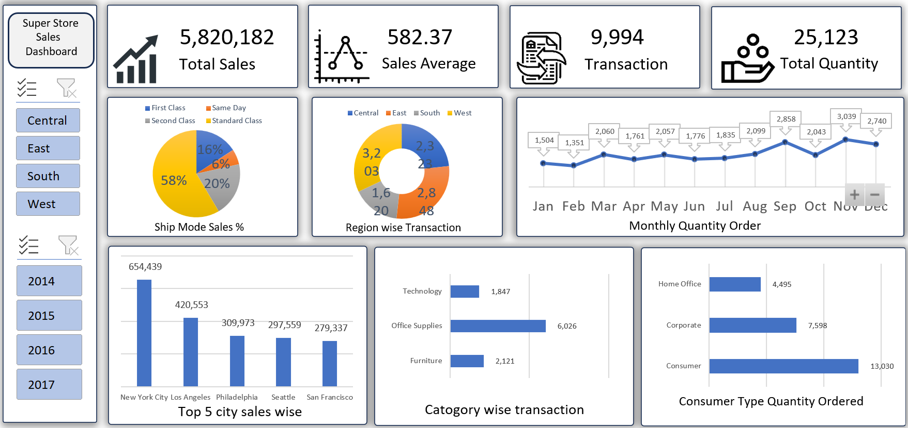

# Excel-Sales-Dashboard
Interactive Super Store Sales Dashboard built in Microsoft Excel to analyze total sales, regional performance, monthly order trends, shipping modes, product categories, and customer segments using Pivot Tables, Charts, and Slicers.

